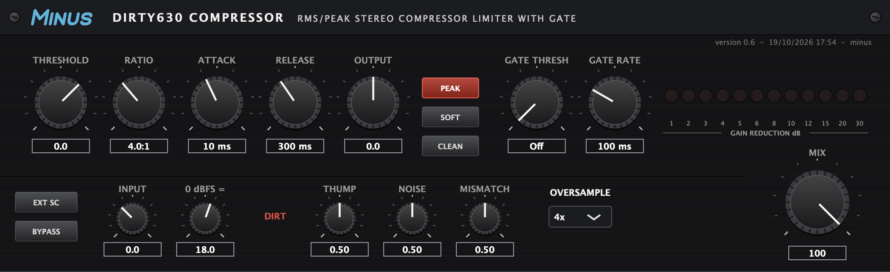

# DIRTY630

A software model of a cheap, loud late-80s stereo VCA compressor/gate — the
one that turned up in every project studio and got used on drums precisely
because it was not clean. VST3 and AU, macOS and Windows.

## Why this compressor

It was built down to a price in 1989 and it sounds like it: noisy, coloured,
and prone to a hard pumping action that most engineers were trying to avoid.
French house went the other way and made that pumping the point. Feed the
sidechain from the kick and everything else ducks and swells around it,
which is the breathing, filtered-disco motion the records are built on.

Daft Punk are the reason the box is remembered. By their own account the
sound of *Homework* and *Discovery* came down to this compressor, and it is
reported on Stardust's "Music Sounds Better With You" too — though at least
one write-up notes a competing claim that a Behringer Composer was doing
the work. Either way, a dirt-cheap unit with a bad reputation ended up
defining the sound of a genre, which is reason enough to model it honestly
rather than politely.

So it is modelled from the circuit rather than fitted to a response, and the
parts that misbehave misbehave for the right reasons: a dbx-style RMS
sensor, a VCA with its symmetry and control-feedthrough errors, a
diode-steered attack/release network, and op-amp stages that saturate at the
rails. Those faults are on their own knobs, so you can dial them out — or
switch to **CLEAN**, which is the hardware's well-known chip-swap mod.

## Install

Download the installer for your platform from the
[latest release](https://github.com/minusro/dirty630/releases/latest).

Neither installer is code-signed, so each operating system blocks it the
first time and has to be told to go ahead. Both write to the system-wide
VST3 folder, so both ask for an administrator password.

### macOS — `dirty630-<version>-macos.pkg`

1. Double-click the pkg. macOS refuses it, saying it "could not verify that
   this software is free from malware". Click **Done**.
2. Open **System Settings → Privacy & Security** and scroll to the Security
   section. Click **Open Anyway** on the message naming the pkg.
3. Confirm, then enter your password when the installer asks.

Installs `DIRTY630.vst3` into `/Library/Audio/Plug-Ins/VST3`.

### Windows — `dirty630-<version>-windows.exe`

1. Run the exe. SmartScreen shows a blue **Windows protected your PC**
   panel. Click **More info**.
2. Click **Run anyway**.
3. Accept the User Account Control prompt.

Installs `DIRTY630.vst3` into `C:\Program Files\Common Files\VST3`.

Then rescan plugins in your DAW. To remove the plugin later, delete the
`DIRTY630.vst3` folder from the path above.

## Using it

One set of controls drives both channels, which are always linked — the
detector listens to the mono sum of the programme, or of the sidechain when
**EXT SC** is on.

| Control | What it does |
|---|---|
| Threshold, Ratio | −40…+20 dB, 1:1 to ∞:1. Past about 99:1 it limits. |
| Attack, Release | 0.1…200 ms, 50 ms…3 s. Fast attack plus a high Thump is where the character lives. |
| Output | ±20 dB of make-up, after the compressor and before the output stage. |
| PEAK | Peak detection instead of RMS. On by default; RMS is the gentler of the two. |
| SOFT | A 10 dB knee instead of a hard one. |
| CLEAN | The chip-swap mod: almost none of the distortion, feedthrough or noise below. |
| Gate Thresh, Gate Rate | Off…+10 dB and 20 ms…2 s. It chatters, as the original does. |
| Mix | Dry/wet, for parallel compression. The dry path stays time-aligned. |
| Oversample | 1×/2×/4×. 4× by default; drop it if you need the CPU back. |
| 0 dBFS = | What full scale means in dBu at the input. 18 dBu by default, so the rails clip around +22 dBu. |

**DIRT** is the deliberate ugliness, each 0…1: **Thump** is control-voltage
feedthrough, heard as a knock on fast attacks; **Noise** is the output
floor; **Mismatch** is how far the two channels drift apart. CLEAN overrides
all three.

### Getting the pump

Put it across the track you want to move — a chord loop, a disco sample, the
whole mix bus — and feed the kick to its sidechain input. Turn **EXT SC**
on so the detector listens to the kick instead of the programme, then set a
high ratio and pull the threshold down until each kick takes a visible bite
out of the ladder. **Release** is the tempo control: long enough that the
level is still climbing when the next kick lands, so the track breathes in
time rather than recovering between hits. Around 100–300 ms suits four to
the floor at house tempos.

Keep **PEAK** on so the kick's transient triggers it rather than its
average, and leave **Thump** up — the knock it puts on the downbeat is part
of why this unit is remembered. If the pumping is too much to sit behind a
vocal, back it off with **Mix** instead of softening the compression.

Four presets ship with it: Default, Drum Bus Smash, NIN Bass and Snare Gate.

What changed between versions is in [`CHANGELOG.md`](CHANGELOG.md).

## Building it yourself

A locally built plugin is signed by nobody but also blocked by nobody. See
[`docs/BUILD.md`](docs/BUILD.md) to build and test, and the rest of
[`docs/`](docs/) for how the model works — [`MODEL.md`](docs/MODEL.md) has
every constant, where it came from, and how to measure the real value on a
real unit.

GPLv3, matching JUCE's licence.
